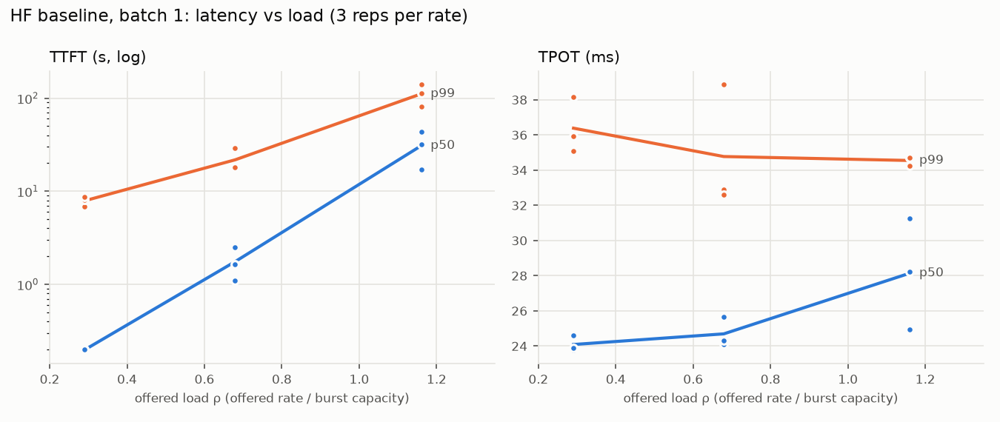
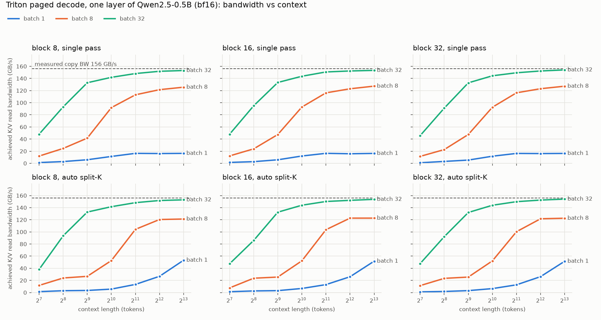
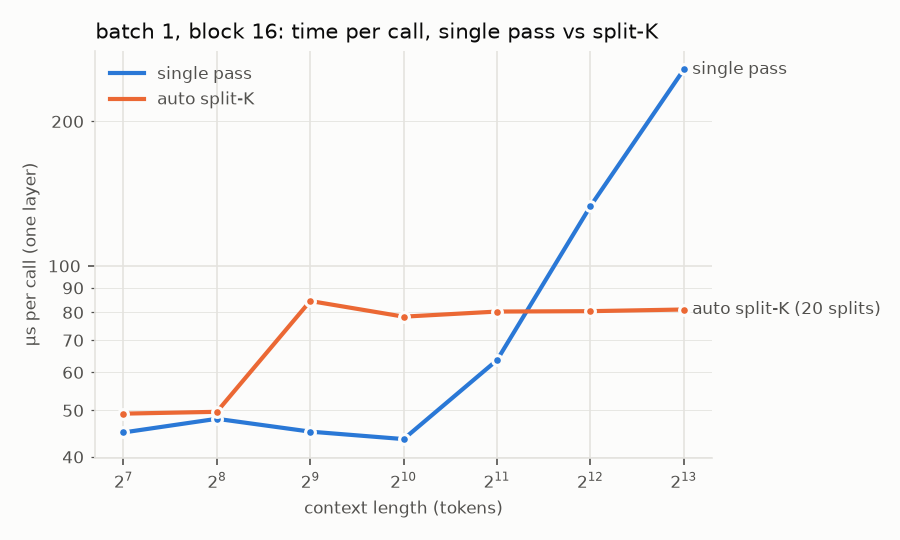
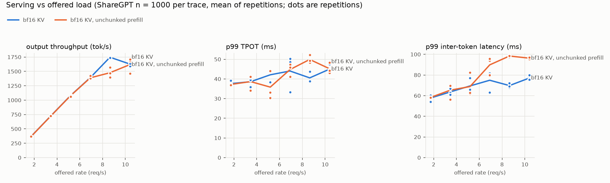
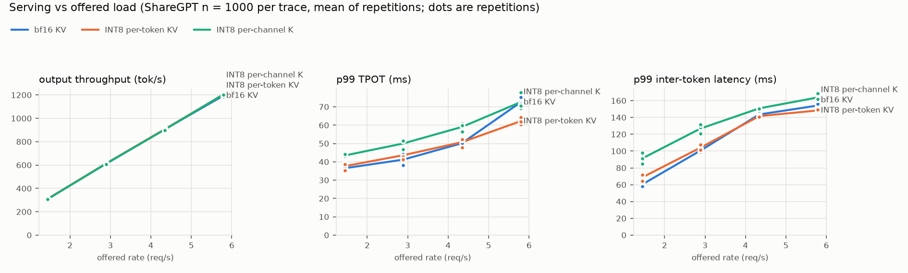

# Small Inference

A small LLM serving engine built from scratch on one laptop GPU: a hand-written Qwen2 forward pass, a paged KV cache, Triton paged-attention decode kernels with split-K, a continuous-batching scheduler with chunked prefill and recompute preemption, and an INT8 KV cache with dequantization fused into the kernel. Every component was tested against a reference before it was measured, and every number below is recomputed from raw logs by one script.

The point of the project is understanding inference systems end to end, so the README reports what was measured, including what didn't work, and keeps the comparison with vLLM honest.

**Status (2026-10-22):** all six phases are built and pass their correctness tests (331 tests). Phases 0, 2, 3, 4, and 5 are measured. The vLLM comparison is partly measured (one repetition of vLLM with CUDA graphs); vLLM eager and the HF-vs-Phase-1 campaign are still to run. See [Remaining work](#remaining-work).

## Headline numbers

| | Result |
|---|---|
| Correctness | fp32 logits **bit-identical to HF** with fused matmuls off (2.4e-4 with them on, from cuBLAS reduction order); paged == contiguous **bit-identical**; batch and preemption invariance hold on greedy tokens |
| Decode kernel | **154 GB/s = 99% of measured copy bandwidth** (batch 32, 8k context); split-K **3.2× faster** at batch 1, 8k context |
| Continuous batching (0.5B) | capacity **8.65 req/s vs 0.147 for HF batch 1 (59×)**; chunked prefill keeps up at 1.0× load where whole-prompt prefill overloads |
| INT8 KV quality (1.5B) | per-channel K: **+0.56% perplexity**; per-token INT8: +8.8% (K outlier channels up to 68× the median) |
| INT8 KV serving (1.5B, 1.5 GiB pool) | when memory binds: **+22% throughput, 0 preemptions vs 416** (per-token INT8); equal throughput when it doesn't |
| vs vLLM 0.32 (preliminary) | ~48% of vLLM-with-CUDA-graphs burst throughput on 0.5B; vLLM's decode step is ~4× faster per token (CUDA graphs remove ~800 launches per step). vLLM eager not yet measured |

## Hardware and setup

- **GPU:** RTX 3050 Laptop, 6 GB GDDR6, Ampere (sm_86), 20 SMs. Measured copy bandwidth 156 GB/s (theoretical 168), bf16 matmul peak 18.7 TFLOP/s, ridge ≈ 120 FLOP/B, kernel launch ≈ 11–20 µs.
- **Host:** Core Ultra 7 155H, 16 GB RAM, Windows 11 + WSL2 (Ubuntu 24.04; WSL gets 7.4 GiB). NVIDIA driver 617.42.
- **Software:** Python 3.12, torch 2.14.1+cu130, Triton 3.8.0, transformers 5.19.0 (reference only), pinned with uv. vLLM 0.32.0 in its own venv (torch 2.13.0).
- **Models:** Qwen2.5-0.5B-Instruct for development, Qwen2.5-1.5B-Instruct where KV memory is scarce (3.1 GB of weights on a 6 GB GPU).
- **Workload:** ShareGPT V3 first turns, tokenized once with the Qwen tokenizer and stored as token ids; fixed output lengths, EOS ignored, greedy decoding; Poisson arrivals from a recorded seed, plus a burst trace. 100 requests per trace for batch-1 engines, 1,000 for the batching engines.
- **Measurement conditions:** plugged in, highest power mode, SM clock locked at 1,927 MHz from Phase 3 on (`nvidia-smi -lgc`), runs shuffled per repetition, GPU cooled to its idle temperature + 3 °C before each run, 3 repetitions unless stated. Every run records environment, GPU/CPU telemetry, and memory-pressure counters ([`docs/system-changes.md`](docs/system-changes.md) logs every machine-state change).

## What's built

```
engine/
  config.py, loader.py   Qwen2 config; safetensors streamed one tensor at a time to the GPU
  model.py, attention.py forward pass: fused QKV and gate/up matmuls, RoPE (rotate_half pairing), GQA attention
  kv_cache.py            contiguous KV cache (Phase 1)
  block_manager.py       paged-cache block manager: LIFO free list, reference counts, free listeners
  paged_cache.py         paged pool [layers, H_kv, blocks, 16, d], packed multi-sequence metadata
  triton_decode.py       Triton paged decode: single pass + split-K + combine; bf16 and two INT8 modes
  scheduler.py           continuous batching: decode-first, chunked prefill, FIFO admission, recompute preemption
  continuous.py          the serving engine (one packed forward per step)
  quant.py, quant_cache.py, triton_quant.py   INT8 formats, quantized caches, fused quantize-and-store kernels
bench/                   open-loop harness, metrics, telemetry, roofline, sweeps, campaigns, figures
tests/                   correctness tests for every component (see below)
docs/                    implementation plan, design log, run queue, system-changes log, figures
```

### Forward pass (Phase 1)
Plain tensors and functions, tokens laid out flat as `[T, ...]` with explicit positions. Q/K/V and gate/up are fused matmuls (`[896, 1152]`, `[896, 9728]` on 0.5B). GQA never copies K/V: the 7 query heads of a group go into the matmul's M dimension (`q` as `[2, 7T, 64]` against K as `[2, 64, S]`), so each KV head is read once. A first version used a broadcast `torch.matmul`, which silently expanded K and V 7×. RoPE's cos/sin rows are gathered once per forward and q and k are rotated together, cutting a decode step from 1,381 to 905 launches (HF: 1,008).

### Paged KV cache (Phase 2)
16-token blocks (192 KiB across 24 layers on 0.5B in bf16; 2 GiB holds 10,922 blocks), pool layout `[layers, H_kv, N, 16, d]` so one head-block is a contiguous 2 KiB. The block manager is pure Python with a LIFO free list (so long-running pools hand out scattered tables) and reference counts. The model only sees `begin / write / attend`, shared by every cache type, and the metadata already packs several sequences into one flat forward.

### Triton decode kernel (Phase 3)
One program per (sequence, KV head) loads the group's 7 query heads as a `[16, 64]` tile and walks the context in 64-token tiles, looking up each token's block (so any block size works with `tl.dot`'s 16-row minimum), with an online softmax. P is not rounded to bf16 for P·V (TF32 on tensor cores), which is the 2-point argmax-agreement gap Phase 1 traced between HF eager and SDPA. Split-K (Flash-Decoding) gives batch-1 long contexts more than 2 programs on 20 SMs; the split policy comes from measurement (split only at ≤ 8 programs and ≥ 3,072 tokens, because the ~80 µs split floor loses at shorter contexts).

### Continuous batching (Phase 4)
Each request holds its `known` tokens (prompt + generated) and `num_computed`; a step computes some of the uncomputed tokens and samples when they're all computed. Prefill, decode, chunked prefill, and recompute are then the same operation, and preemption is "free the blocks, set `num_computed` to 0, requeue at the front". Per step: decodes first, then partial prefills, then FIFO admissions under a 512-token budget (Sarathi-Serve). Admission reserves the whole prefill's blocks; reserving chunk by chunk could deadlock two half-prefilled requests, which was caught in review before testing.

### INT8 KV cache (Phase 5, the contribution)
Three formats behind the same cache interface:

| Format | K | V | Bytes/token (0.5B / 1.5B) |
|---|---|---|---|
| bf16 | bf16 | bf16 | 12,288 / 28,672 |
| INT8 per-token | int8 + fp16 scale per (token, head) | same | 6,336 / 14,560 |
| INT8 per-channel K | int8 + fp16 scale per (16-token block, head, channel); the partial last block stays bf16 until it fills | per-token | 6,624 / 15,344 |

Dequantization is fused into the decode kernel: per-token K scales multiply the score columns after an exact int8→bf16 tensor-core dot, V scales fold into P, per-channel K is dequantized on the tile with its block's scales. Writes use fused Triton quantize-and-store kernels that are bit-identical to the PyTorch reference (round-half-even and correctly rounded division).

## Correctness

| Invariant | Test | Result |
|---|---|---|
| 1. Logits match HF | `tests/test_model_hf.py` | bit-identical in fp32 with fused matmuls off; 2.4e-4 (8e-6 relative) with fusion; bf16 argmax agreement with fp32 95.5% (HF bf16 eager: 95.6%) |
| 2. Cached == uncached | `test_model_hf.py`, `test_model_unit.py` | 50 greedy fp32 tokens identical, including a 1-token prompt, and equal to HF's own greedy decode |
| 3. Block manager has no leaks | `tests/test_block_manager.py` | 50 seeds × 400 random operations, consistency checked after every one |
| 4. Paged == contiguous | `tests/test_paged.py` | bit-identical (bf16 and fp32) for lengths 1, 15, 16, 17, 33 in shuffled pools |
| 5. Kernel == reference | `tests/test_decode_kernel.py`, `test_quant_cache.py` | ragged batches, shuffled tables, block sizes 8/16/32, both head layouts, single/split, all three KV formats; mutation-checked (three planted bugs each fail 26–44 cases) |
| 6. Batch invariance | `tests/test_scheduler.py`, `test_continuous_hf.py` | identical greedy tokens alone and in every tested mix (fp32, 0.5B) |
| 7. Forced preemption | same | outputs unchanged under repeated preemption mid-decode; no leaked blocks |

INT8 caches cannot satisfy 6 and 7 by design: filling the same tokens in a different order gives identical layer-0 int8 values, but fp32 order noise flips a few roundings, each flip is a whole quantization step, and the perturbation compounds over layers. INT8 is judged by fidelity instead.

Run the suite with `.venv/bin/python -m pytest` (about 2.5 minutes; GPU tests skip without CUDA). Timing-heavy tests are marked `slow`.

## Results

All figures are rebuilt from raw logs with `.venv/bin/python -m bench.make_figures` (sources in [`docs/figures/sources.json`](docs/figures/sources.json)).

### Phase 0: harness and HF baseline
The open-loop harness was validated against a fake engine with known timing (TPOT within 1.7%). HF transformers at batch 1 (bf16, SDPA): mean service time 6.8 s per request, capacity ≈ 0.15 req/s, TPOT 24–28 ms against a 6.3 ms bandwidth bound: it is CPU-bound, with 1,006 kernel launches per decode step. Even at 0.3× load, 18% of requests miss a 2 s TTFT from head-of-line blocking, as M/G/1 predicts.



### Phase 1: forward pass
Decode-step profile, 3 interleaved runs (unprofiled p50): HF 24.7–26.2 ms, Phase 1 18.4–32.0 ms, the Phase 4 engine at batch 1 17.7–27.3 ms. The spread is not the engines: see [Limitations](#limitations). The harness campaign comparing HF and Phase 1 is still to run.

### Phase 2: cost of the paged gather
The Phase 2 reference attention gathers each sequence's blocks into contiguous K/V. In GPU kernel time this costs 1.5–2.0× contiguous attention (stable to ~1% across runs): +0.15–0.89 ms per 24-layer step at batch 1, +7.3 ms at batch 8 with 4k context. That is the baseline the Phase 3 kernel removes.

### Phase 3: decode kernel bandwidth


Batch 32 at 8k reaches 154 GB/s (99% of measured copy bandwidth); batch 8 ≈ 125 GB/s; single-pass batch 1 plateaus near 16 GB/s on 2 programs. Split-K at batch 1: 257 → 81 µs per layer at 8k (3.2×), 132 → 81 µs at 4k, but slower below ~2.5k tokens.



### Phase 4: continuous batching (0.5B, n = 1,000, 3 repetitions)


Capacity 8.65 req/s (59× HF batch 1); output throughput saturates near 1,750 tok/s. At 1.0× capacity the chunked engine keeps up (TTFT p50 0.09 s, 1,746 tok/s) while whole-prompt prefill is overloaded (TTFT p50 14 s, 1,477 tok/s), and p99 inter-token latency at 0.8–1.0× is 63–82 ms chunked vs 80–99 ms unchunked. Under 1.2× overload the chunked engine has the worse TTFT (16.4 vs 9.6 s): decode-first scheduling makes admissions wait, the expected Sarathi trade-off. Table: [`docs/figures/phase4/serving_0.5B.md`](docs/figures/phase4/serving_0.5B.md).

### Phase 5: INT8 KV cache
Quality (20 ShareGPT documents, prefilled in 64-token chunks so later chunks attend to quantized K/V):

| | 0.5B perplexity | 1.5B perplexity | 1.5B mean KL vs bf16 | 1.5B top-1 agreement | K rel. error (1.5B) |
|---|---|---|---|---|---|
| bf16 | 8.633 | 6.953 | — | — | — |
| INT8 per-token | 8.984 (+4.1%) | 7.565 (+8.8%) | 0.118 nats | 89.2% | 1.19% |
| INT8 per-channel K | 8.649 (+0.19%) | 6.992 (+0.56%) | 0.039 nats | 94.1% | 0.34% |

Qwen's K projection has biases, and K has outlier channels (largest channel absmax up to 68× the median on 1.5B); per-token scales let those set the step for every other channel. Decode kernel at 32 × 4k per layer: bf16 / per-token / per-channel = 420 / 244 / 356 µs (0.5B) and 835 / 577 / 929 µs (1.5B). Full tables: [`docs/figures/phase5/`](docs/figures/phase5/).

Serving on 1.5B with a 1.5 GiB KV pool and up to 256 sequences (3 repetitions):



| | bf16 | INT8 per-token | INT8 per-channel K |
|---|---|---|---|
| Burst (pool binds) | 1,289 tok/s, 416 preemptions | **1,574 tok/s (+22%), 0** | 1,456 tok/s (+13%), 0 |
| TPOT p50 at 1.45 / 5.79 req/s | 30.8 / 58.3 ms | 31.2 / **47.3** ms | 32.7 / 53.1 ms |

Below the point where memory binds, the three formats tie on throughput. The trade-off left is quality (per-channel K) against speed (per-token INT8).

### Phase 6: vLLM 0.32 (preliminary)
vLLM ran with the same traces, greedy decoding, EOS ignored, the same 64-sequence and 512-token limits, no prefix caching, and its KV cache matched to ours (131,072 tokens; vLLM: 131,088 eager, 133,344 with CUDA graphs). One repetition of vLLM with CUDA graphs is complete; ours is from the Phase 4 campaign two days earlier, so this is not yet a same-session comparison.

| 0.5B, n = 1,000 | vLLM (CUDA graphs, 1 rep) | this engine (3 reps) |
|---|---|---|
| Burst throughput | 4,138 tok/s | 1,969 tok/s (**48%**) |
| TPOT p50 at 1.73 / 8.65 req/s | 7.1 / 8.6 ms | 27.8 / 30.7 ms |
| At 10.4 req/s | keeps up (TTFT p50 0.04 s) | overloaded (TTFT p50 16.4 s) |

Most of the gap is launch overhead: this engine issues ~800 kernel launches per decode step through WSL's GPU paravirtualization (17+ ms of CPU-side enqueue), and a CUDA graph replays a whole step in one. The eager-vs-eager comparison, which isolates scheduling and kernel quality, is the next run.

## Limitations

- **One laptop, WSL2.** Kernel launches go through WSL's GPU paravirtualization. Batch-1 decode is launch-bound, and its CPU-side enqueue time varies between host states that last tens of seconds (17.3 → 20.9+ ms for ~900 launches), even with the SM clock locked and Python speed unchanged; this is below the WSL/driver boundary. Small-batch timings carry that noise; campaigns interleave engines across shuffled repetitions so it spreads evenly.
- **GPU clock policy.** Without a lock the driver judged launch-bound decode "idle" and held ~1,200 MHz for tens of seconds (a 19 vs 32 ms step); timing runs from Phase 3 on use a locked SM clock, which a reboot clears.
- **Power limit.** After a Windows update the enforced power limit varied 77–90 W per run (75 W before); the Phase 5 serving repetitions all ran in one session under that regime.
- **Interruptions.** Windows Update restarted the laptop once mid-campaign; that run was redone in full. vLLM's eager engine core hung once mid-run (GPU idle, engine core at 100% CPU for 13 h; not inspectable without admin rights); the campaign driver now kills and records hung children.
- **Scope.** Two small models, one workload (ShareGPT first turns), greedy decoding only, no CUDA graphs in this engine, no prefix caching, no speculative decoding. vLLM's FlashInfer sampler was disabled (its JIT build fails with the venv's CUDA 13.4 `nvcc`); with greedy decoding the PyTorch sampler is equivalent.

## Reproducing

```bash
uv sync                                         # pinned environment (.venv)
.venv/bin/python -m pytest                      # correctness suite (~2.5 min)
.venv/bin/python -m bench.decode_sweep          # Phase 3 kernel sweep
.venv/bin/python -m bench.kv_quant_eval --timing --model Qwen/Qwen2.5-1.5B-Instruct   # Phase 5 table
.venv/bin/python -m bench.baseline --engines continuous,continuous-nochunk --n 1000 \
    --rates 1.73,3.46,5.19,6.92,8.65,10.4      # Phase 4 campaign (~4 h)
.venv/bin/python -m bench.make_figures          # every figure and table from raw logs
```

The full run queue, with each command, its duration, its load, and what it unlocks, is [`docs/deferred-runs.md`](docs/deferred-runs.md). Traces are in `traces/` and every run's raw records are in `results/` (never edited by hand). Commit hashes changed when the history was rewritten on 2026-10-22; [`docs/commit-map.md`](docs/commit-map.md) maps the hashes recorded in older `results/*/env.json` files to the current ones.

## Remaining work

1. **Finish the vLLM comparison** (Phase 6): repetitions 1–3 of vLLM eager and of this engine, and repetitions 2–3 of vLLM with CUDA graphs, interleaved in one session (`bench.process_reps --resume`, ~4.5 h). Then report "X% of vLLM eager throughput at Y req/s".
2. **HF vs Phase 1 campaign** (Phase 1's TPOT-vs-HF gate): burst + 3 rates, 3 repetitions, with the current measurement code (~8 h).
3. **CUDA graphs for decode** (the Phase 4 stretch goal): the measured gap to vLLM is mostly launch overhead.
4. **Per-channel K kernel**: fold the per-block channel scales into q so QKᵀ runs on int8-converted K; today it is about bf16 speed while per-token INT8 is 1.4–1.7× faster.
5. **Write-up pass**: rebuild every figure, go through Heiser's "Systems Benchmarking Crimes" checklist, and turn this README's preliminary Phase 6 numbers into final ones.

## Documents

- [`docs/implementation-plan.md`](docs/implementation-plan.md): every milestone, its gate, and its measured result
- [`docs/design-log.md`](docs/design-log.md): decisions, failed attempts, and why
- [`docs/deferred-runs.md`](docs/deferred-runs.md): the run queue and the record of every heavy run
- [`docs/system-changes.md`](docs/system-changes.md): every change to the machine's state (clocks, power, updates)

## References

kipply, *Transformer Inference Arithmetic*; Horace He, *Making Deep Learning Go Brrrr From First Principles*; Kwon et al., *PagedAttention* (SOSP 2023); Dao, *FlashAttention-2*; *Flash-Decoding*; Yu et al., *Orca* (OSDI 2022); Agrawal et al., *Sarathi-Serve* (OSDI 2024); Liu et al., *KIVI* (2024); Hooper et al., *KVQuant* (2024); Heiser, *Systems Benchmarking Crimes*.
